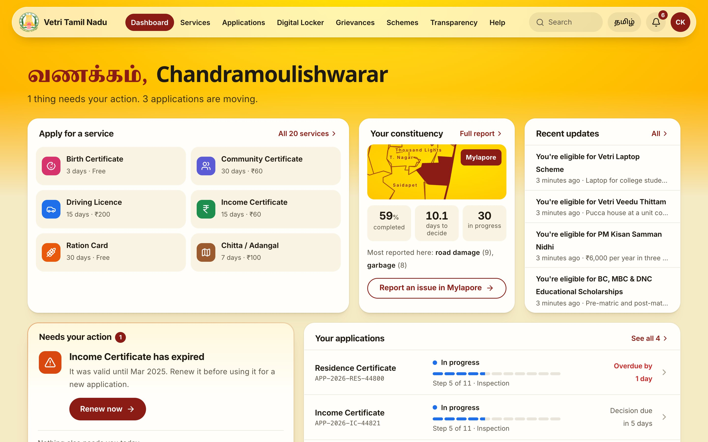
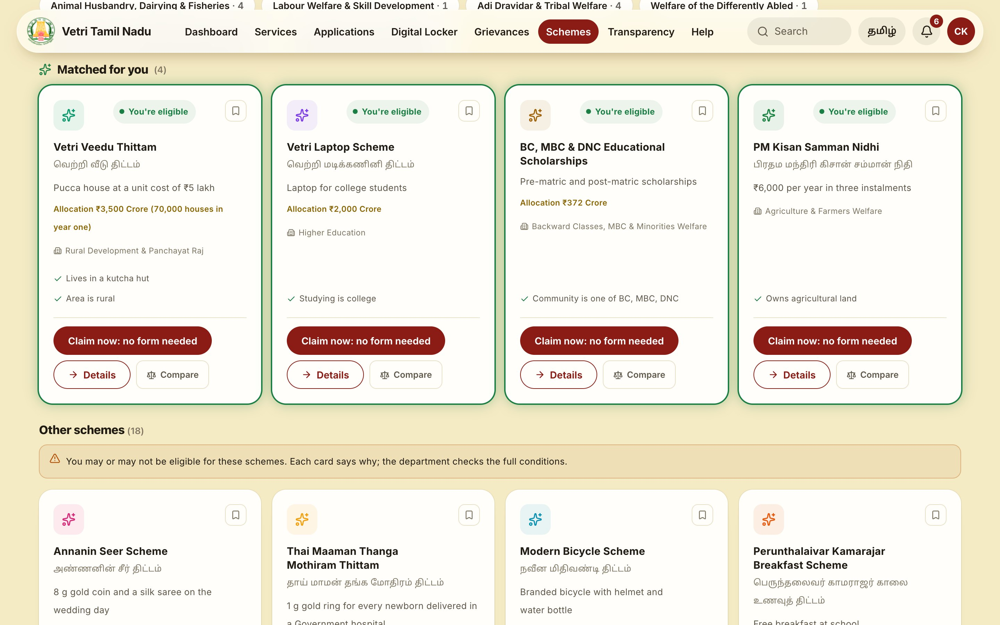
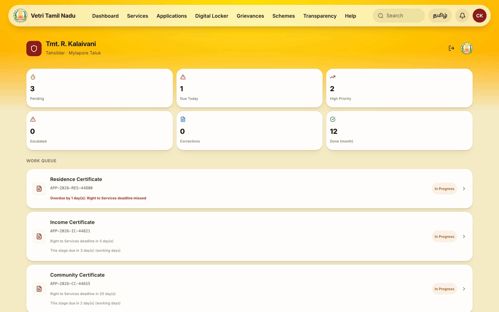
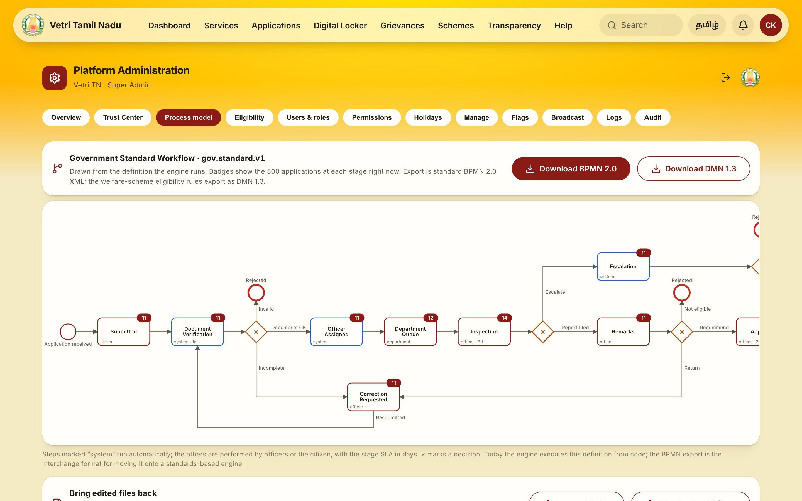
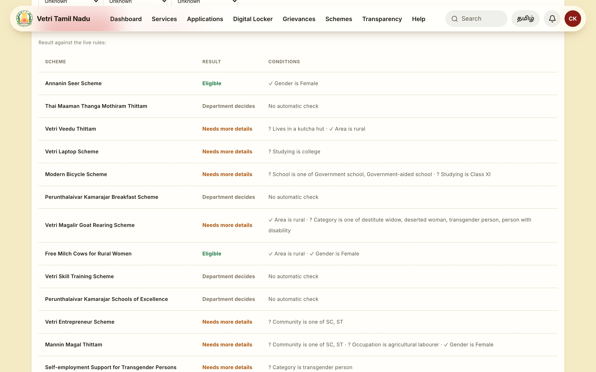
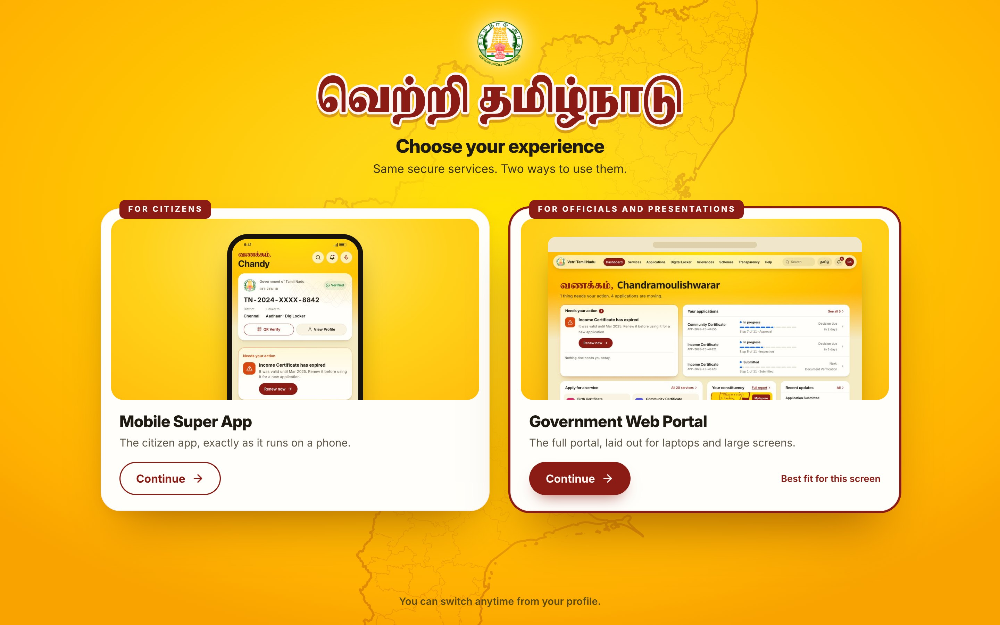
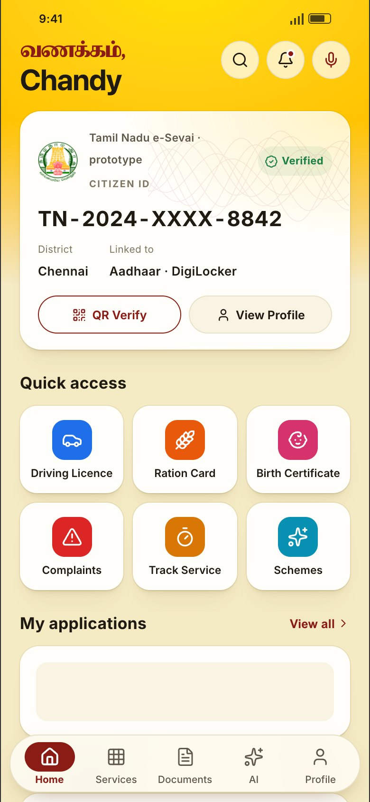
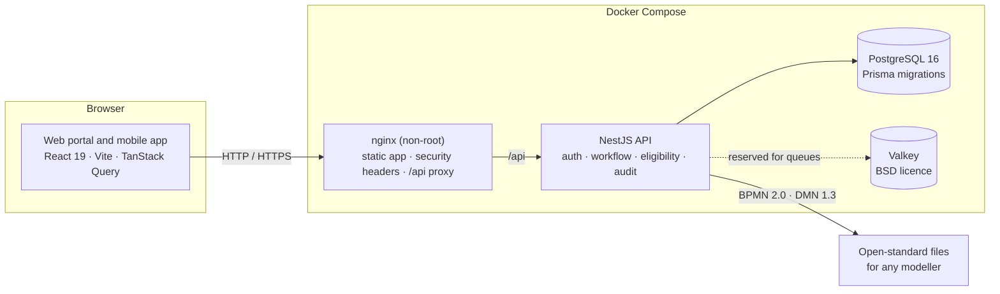

<div align="center">

# வெற்றி தமிழ்நாடு · Vetri Tamil Nadu

### One digital front door for every Tamil Nadu citizen service

Apply for certificates, track every application live, claim welfare schemes you qualify for without filling a form, and give officers a worklist that runs on Right to Services deadlines.




</div>

---

## Contents

1. [What it does](#-what-it-does)
2. [Screenshots](#-screenshots)
3. [Run it in VS Code, step by step](#-run-it-in-vs-code-step-by-step)
4. [Sign in and take the tour](#-sign-in-and-take-the-tour)
5. [Everyday commands](#-everyday-commands)
6. [Troubleshooting](#-troubleshooting)
7. [Architecture and tech stack](#-architecture-and-tech-stack)
8. [Project structure](#-project-structure)
9. [Security and open standards](#-security-and-open-standards)
10. [Documentation](#-documentation)

---

## ✨ What it does

| For citizens | For officers | For administrators |
|---|---|---|
| Apply for 20+ services (certificates, licences, land records) | A worklist sorted by deadline, with overdue cases flagged | Live BPMN process map of the workflow the engine runs |
| Track each application stage by stage, updated live | Approve, reject, return, forward, escalate, seek a report | Export the workflow as **BPMN 2.0** and scheme rules as **DMN 1.3**, and import edited files back |
| **"Matched for you"**: welfare schemes checked against your profile, claimed in one tap | Two-person approval: the officer who recommends cannot approve | Test eligibility rules on a sample citizen before publishing |
| Certificates in a digital wallet, verifiable by QR | Grievance redressal workflow with reminders | Users, roles and permissions; holiday calendar; tamper-evident audit trail |
| Tamil and English throughout | Pop-up alerts when new cases arrive | Trust Center showing the platform's security posture |

The scheme catalogue follows the **Tamil Nadu Revised Budget 2026-27** (speech of 5 August 2026): 22 schemes, each with only the eligibility conditions the source states.

---

## 📸 Screenshots

<table>
  <tr>
    <td width="50%"><br /><b>Matched for you</b>: schemes whose conditions you meet, claimed without a form</td>
    <td width="50%"><br /><b>Officer worklist</b>: deadlines in working days, overdue cases first</td>
  </tr>
  <tr>
    <td><br /><b>Process model</b>: live counts per stage, BPMN 2.0 and DMN 1.3 export</td>
    <td><br /><b>Rule tester</b>: try a sample citizen against the live rules or a draft</td>
  </tr>
  <tr>
    <td><br /><b>Two experiences</b>: the phone app or the full web portal</td>
    <td align="center"><br /><b>Mobile app</b>: citizen ID, quick access and applications</td>
  </tr>
</table>

---

## 🚀 Run it in VS Code, step by step

### Before you start: install these once

| Tool | Why | Get it |
|---|---|---|
| **Visual Studio Code** | The editor and its built-in terminal | [code.visualstudio.com](https://code.visualstudio.com/) |
| **Git** | Download the project | [git-scm.com](https://git-scm.com/downloads) |
| **Docker Desktop** (or Docker Engine) | Runs the database, API and web portal | [docker.com](https://www.docker.com/products/docker-desktop/) |
| **Node.js 22 LTS** | Only for development mode and tests | [nodejs.org](https://nodejs.org/) |

Start **Docker Desktop** and wait until it says *Running* before step 4.

### Step 1: Download the project

Open VS Code, then **Terminal → New Terminal** (or press <kbd>Ctrl</kbd> + <kbd>`</kbd>). Run:

```bash
git clone https://github.com/moulishk2205/VetriTamilNadu_SuperApp.git
cd VetriTamilNadu_SuperApp
code .
```

A new VS Code window opens on the project. Accept **Install** when VS Code suggests the recommended extensions (ESLint, Prisma, Docker).

> No `code` command? In VS Code press <kbd>Cmd</kbd>/<kbd>Ctrl</kbd> + <kbd>Shift</kbd> + <kbd>P</kbd>, run **Shell Command: Install 'code' command in PATH**, then open the folder with **File → Open Folder** this once.

### Step 2: Open the terminal in the project folder

In the new window: **Terminal → New Terminal**. The prompt should end in `VetriTamilNadu_SuperApp`. Every command below starts from here.

### Step 3: Create the API settings file

```bash
cd backend
cp .env.example .env
```

On Windows (Command Prompt) use `copy .env.example .env`.

Open `backend/.env` in VS Code and replace the three `change-me…` values with your own. For the secret, this prints a strong one to paste:

```bash
openssl rand -hex 32
```

Leave `AUTH_MOCK=true` and `SEED_ON_BOOT=true` for a demo: you get sample data and can sign in with OTP `123456`.

### Step 4: Start everything with Docker

Still inside `backend`:

```bash
docker compose up -d --build
```

The first run builds the images and takes about 3 to 5 minutes. Check that all four services report **healthy**:

```bash
docker compose ps
```

### Step 5: Open the app

| What | Address |
|---|---|
| **Web portal** (the app) | **http://localhost:8080** |
| API | http://localhost:4000/api |
| API health check | http://localhost:4000/health |

That's it: the whole platform is running. Sign in as described in [Sign in and take the tour](#-sign-in-and-take-the-tour).

### Optional: development mode with instant reload

Use this when you are changing the frontend: every save in `src/` shows up in the browser immediately. Keep the Docker services from step 4 running, then open a **second terminal** (click **+** in the terminal panel) at the project root:

```bash
cp .env.example .env.local
npm install
npm run dev
```

Open **http://localhost:5173**. The dev server forwards `/api` to the API on port 4000.

> VS Code shortcut: <kbd>Cmd</kbd>/<kbd>Ctrl</kbd> + <kbd>Shift</kbd> + <kbd>P</kbd> → **Tasks: Run Task** → **VETRI: start the platform (Docker)** or **VETRI: web dev server (hot reload)**.

### Optional: run the API from source

For changing the backend without rebuilding images:

```bash
cd backend
docker compose -f docker-compose.yml -f docker-compose.dev.yml up -d postgres redis
npm install
npx prisma generate
npx prisma migrate deploy
npm run db:seed
npm run start:dev
```

Uncomment `DATABASE_URL` in `backend/.env` first and put the same password as `POSTGRES_PASSWORD` in it. The API then runs on http://localhost:4000 and restarts on every save. Stop the Docker `backend` service first (`docker compose stop backend`) so port 4000 is free.

---

## 🔑 Sign in and take the tour

With `AUTH_MOCK=true` you have two ways in:

- **Presentation mode**: open **http://localhost:8080/demo**, pick **Government Web Portal**, then click a persona.
- **OTP sign-in**: any 10-digit mobile number, then the code **`123456`** (shown on screen).

| Persona | Who | Lands on |
|---|---|---|
| **Citizen** | Chandramoulishwarar K · Mylapore | Dashboard |
| **Officer** | Tmt. R. Kalaivani · Tahsildar | Worklist |
| **Approving Officer** | Thiru. S. Venkatesan · RDO (second signature) | Worklist |
| **Department** | Revenue & Disaster Management | Department view |
| **MLA** | Mylapore Assembly Constituency | Constituency analytics |
| **Super Admin** | Platform administration | Admin portal |

**A five-minute tour**

1. **Citizen → Schemes.** Answer the questions in *For you, from your profile* (for example a rural area and a kutcha hut). Schemes you now qualify for move to **Matched for you** with a glowing border, and a notification arrives. Click **Claim now**.
2. **Citizen → Applications.** Open one and follow its stage timeline.
3. **Officer** in a second window: act on one of the citizen's applications. Within about 8 seconds the citizen's window updates and shows an alert, with no reload.
4. **Super Admin → Process model.** See the live workflow, download the BPMN and DMN files, then use **Eligibility** to test a sample citizen.
5. **Verify a certificate.** Open a certificate in the citizen's Digital Locker and scan or open its QR link.

---

## 🧰 Everyday commands

Run from the `backend` folder unless noted.

| Task | Command |
|---|---|
| Start the platform | `docker compose up -d --build` |
| See status | `docker compose ps` |
| Follow the API log | `docker compose logs -f backend` |
| Stop (keeps your data) | `docker compose down` |
| Reset to fresh demo data | `docker compose down -v` then `docker compose up -d --build` |
| Apply catalogue updates to an existing database | `docker exec vetri-backend node dist/prisma/sync-schemes.js` |
| Unit tests | `npm install && npx prisma generate && npm test` |
| End-to-end tests (platform running) | `npm run test:e2e` |
| Frontend type check (project root) | `npx tsc --noEmit -p tsconfig.json` |
| Licence check and SBOM (project root) | `npm run sbom` |

**Share the demo over the internet** (optional). This starts a temporary public address through Cloudflare:

```bash
docker compose -f docker-compose.yml -f docker-compose.tunnel.yml up -d tunnel
docker logs vetri-tunnel 2>&1 | grep -o "https://[a-z0-9-]*\.trycloudflare\.com" | tail -1
```

Set `TRUST_PROXY=2` in `backend/.env` first, so each visitor gets their own rate limit. The address changes whenever the tunnel restarts.

---

## 🩺 Troubleshooting

| Symptom | Fix |
|---|---|
| `set POSTGRES_PASSWORD` or similar when starting | `backend/.env` is missing or a value is empty. Repeat step 3. |
| `Cannot connect to the Docker daemon` | Start Docker Desktop and wait until it says *Running*. |
| `port is already allocated` (8080, 4000 or 5173) | Another program uses the port. Stop it, or stop old containers with `docker compose down`. |
| The page loads but shows no data | Check `docker compose ps`: the backend must be *healthy*. Then `docker compose logs backend`. |
| `Refusing to seed: database already holds … citizens` | The database already has data; nothing is wrong. To start over: `docker compose down -v`. |
| Changed `POSTGRES_PASSWORD` and the API can't connect | Postgres keeps its first password. Reset with `docker compose down -v` (deletes data). |
| No OTP arrives | No SMS gateway is connected yet. With `AUTH_MOCK=true` the code is `123456` and is shown on screen. |
| `npm run dev` shows API errors | The Docker services from step 4 must be running, and `.env.local` must exist. |

---

## 🏗 Architecture and tech stack



| Layer | Technology |
|---|---|
| Web portal and mobile app | React 19, Vite, TypeScript, TanStack Query, Zustand, Zod, Lucide icons |
| API | NestJS 10, Passport JWT, class-validator, Helmet, rate limiting, Pino logs, Swagger |
| Data | PostgreSQL 16, Prisma 5 with versioned migrations |
| Workflow and rules | Built-in stage engine with working-day deadlines; BPMN 2.0 export and conformance check; DMN 1.3 export and import |
| Delivery | Docker Compose; nginx (unprivileged) web image; Node 22 API image as a non-root user |
| Quality | Jest unit and end-to-end tests; GitHub Actions CI; CycloneDX SBOM with a licence gate |

---

## 🗂 Project structure

```text
VetriTamilNadu_SuperApp/
├── src/                     Web portal and mobile app (React)
│   ├── app/                 Shells, routing, providers
│   ├── features/            One folder per feature (schemes, officer, admin, …)
│   └── lib/                 API client, i18n, live updates
├── backend/                 NestJS API
│   ├── src/modules/         auth, applications, officer, eligibility, workflow, admin, …
│   ├── prisma/              Schema, migrations, seed, scheme catalogue
│   ├── test/                Unit and end-to-end tests
│   └── docker-compose*.yml  The platform, development and tunnel setups
├── deploy/nginx.conf        Web portal server settings
├── Dockerfile.web           Web portal image
├── docs/                    Architecture, licence register, SBOM, EOI readiness
└── .github/workflows/       Continuous integration
```

---

## 🛡 Security and open standards

- **Sign-in**: one-time codes stored only as hashes, limited attempts and requests; sessions you can end; refresh tokens rotated on every use.
- **Access control**: roles and fine-grained permissions checked on every request, editable by administrators; two-person approval for decisions.
- **Audit**: every change is written to a hash-chained trail that shows any edit or deletion; exportable for review.
- **Certificates**: signed and checkable by anyone through the QR link.
- **Deployment**: containers run as non-root users; the API port is open only on the machine itself, so other devices reach it through the web portal; strict security headers.
- **Open standards**: the workflow exports as **BPMN 2.0** and the scheme rules as **DMN 1.3**, so they open in any standard modeller (bpmn.io, Camunda Modeler).
- **No recurring licence fees**: every component is open source; see the [licence register](docs/LICENCE-REGISTER.md) and the [SBOM](docs/sbom/).

---

## 📚 Documentation

| Document | What's inside |
|---|---|
| [backend/README.md](backend/README.md) | API details, Docker options, demo data, backups |
| [docs/ARCHITECTURE.md](docs/ARCHITECTURE.md) | How the parts fit together |
| [docs/LICENCE-REGISTER.md](docs/LICENCE-REGISTER.md) | Licences of every component, container image and font |
| [docs/EOI-eSevai2-readiness.md](docs/EOI-eSevai2-readiness.md) | Readiness against the e-Sevai 2.0 EOI requirements |

---

<div align="center">

**Licence:** proprietary. All rights reserved. See [LICENSE](LICENSE) and third-party notices in [NOTICE](NOTICE).

</div>
